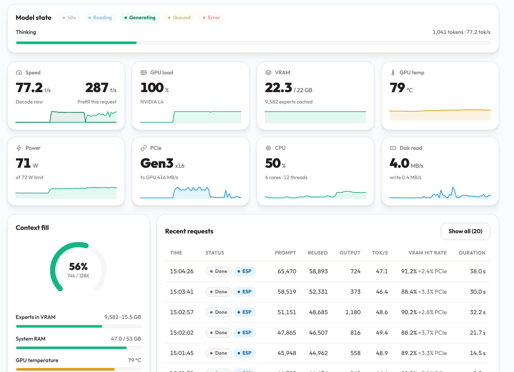
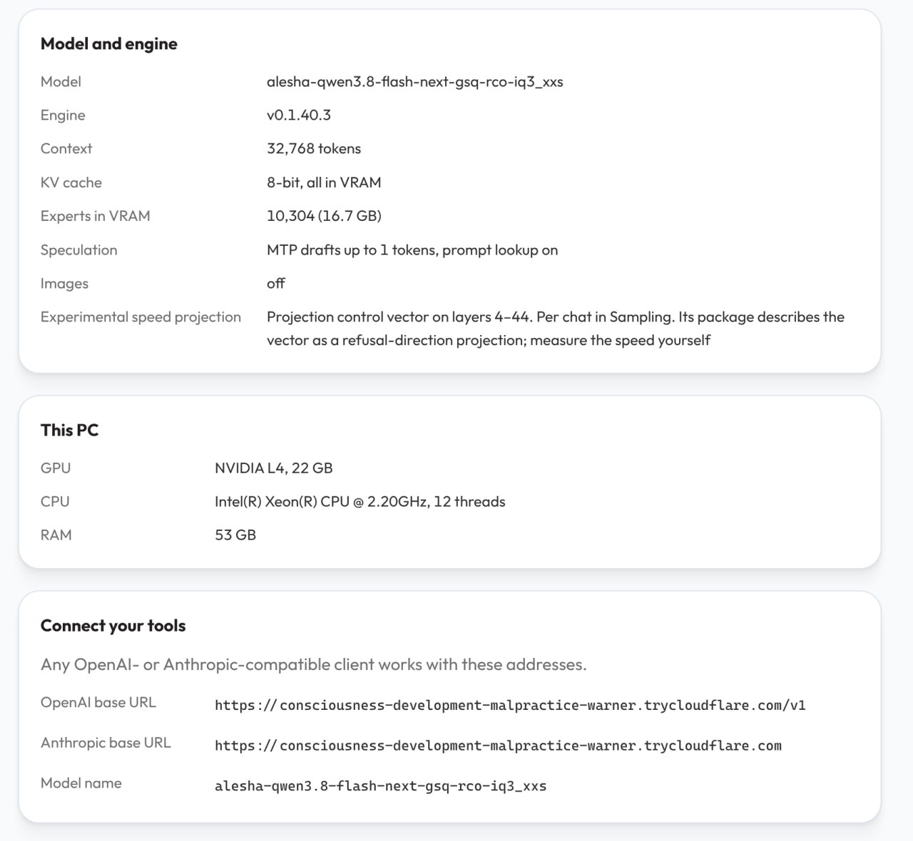

[**中文**](README.md) | [English](README.en.md)

# Strata L4 · GSQ-RCO IQ3_XXS

> 权重来源：[alesha-pro/Qwen3.8-Flash-Next-abliterated-GSQ-RCO-Strata-GGUF](https://huggingface.co/alesha-pro/Qwen3.8-Flash-Next-abliterated-GSQ-RCO-Strata-GGUF)

本项目在 Google Colab L4 High-RAM 环境运行 Qwen3.8-Flash-Next 的 GSQ-RCO IQ3_XXS 权重与拒绝方向控制向量，提供带鉴权的 OpenAI 兼容 Chat Completions API。项目用于个人交互推理、代码 agent 与长上下文实验，消耗已有 Google Colab Pro 订阅的每月计算额度。

入口文件为 [strata_l4_gsq_rco_iq3_xxs.py](strata_l4_gsq_rco_iq3_xxs.py)，已生成的 notebook 为 [strata_l4_gsq_rco_iq3_xxs.ipynb](strata_l4_gsq_rco_iq3_xxs.ipynb)。源文件使用 `# %%` 分隔单元格。

## 性能与硬件规范

此前在 L4 实例的 128K / int8 KV 配置下（关闭 MTP），实测对话解码速度约为 32 到 57 tokens/s（tps），峰值可达 80+ tps。实际速度受 CPU 性能、上下文长度、专家缓存命中率与草稿接受率影响。

| 项目 | 配置与指标 |
|---|---|
| 推荐实例 | L4 GPU + High-RAM |
| 引擎版本 | Strata release v0.2.12，对应引擎 0.1.58 |
| 运行时资源 | 约 22 GiB 可用显存，53 GiB 系统内存 |
| 默认量化 | IQ3_XXS，2 个分片文件共约 75.8 GB |
| 专家内存 | 专家权重约占 43 GB，启动前检查可用内存至少 48 GiB |
| 默认上下文长度 | 262,144 tokens，k8v4 KV streaming，显存缓存窗口 32,768 |
| KV 内存占用 | 256K 主模型完整 KV 缓存按引擎格式计算约占 2.39 GiB 系统内存 |
| 长输入测试（此前 128K 配置） | 34,043 tokens，正确回忆开头标记，耗时约 60 秒 |
| 测试后剩余内存（此前 128K 配置） | 约 6.4 GiB 可用系统内存 |



256K 为基础模型的原生上下文长度。主机 KV 缓存按配置上限在启动时分配。256K 下 k8v4 主模型 KV 约为 2.39 GiB，比 int8 的 3.09 GiB 少约 0.70 GiB；此数字不包含 MTP 草稿层的 int8 KV，进程总内存与显存峰值还受其他缓冲区影响。项目尚未实测 L4 上的 256K 配置，也未对完整 128K 或 256K 输入进行压力测试。34K 测试耗时包含预填充耗时，不代表纯解码速度。服务默认仅处理文本输入。首次源码编译需要 10 到 30 分钟。磁盘检查要求剩余空间大于下载文件总大小加 24 GiB 工作空间。

## 模型权重与控制向量

模型权重来自 [alesha-pro/Qwen3.8-Flash-Next-abliterated-GSQ-RCO-Strata-GGUF](https://huggingface.co/alesha-pro/Qwen3.8-Flash-Next-abliterated-GSQ-RCO-Strata-GGUF)，基于 [ISTA-DASLab GSQ-RCO 量化版本](https://huggingface.co/ISTA-DASLab/Qwen3.8-Flash-Next-GSQ-RCO-GGUF)，并附带从 Huihui 检查点提取的拒绝方向控制向量。权重文件未做修改。[Strata](https://github.com/Niko1221/Strata) 引擎在推理时动态投影控制向量，默认作用于第 4 到 44 层，强度设为 1.0。

原仓库作者测试了 IQ3_S 与 IQ2_XS 量化，未测试 IQ3_XXS。作者报告两档量化通过 5 个小型代码工具任务与 32K/115K 标记检索测试。在 RTX 3090 与 EPYC 平台上，32K 上下文的解码速度约为 59 与 87 tps。该测试结果仅供能力参考，不代表 Colab L4 的表现。详细数据参见[原仓库测量说明](https://huggingface.co/alesha-pro/Qwen3.8-Flash-Next-abliterated-GSQ-RCO-Strata-GGUF#measurements)。

代码同时支持 IQ2_XS（约 68 GB 下载量，35.5 GB 专家内存）与 IQ3_S（约 83.6 GB 下载量，50 GB 专家内存）。在 53 GiB 内存的运行时中默认使用 IQ3_XXS，调优保留主模型量化等级，默认 KV 改为 k8v4。若内存紧张，先减小预填充分块或关闭 MTP 做对照；仅在明确接受精度取舍时选择更低量化。模型许可证参见 [Hugging Face LICENSE](https://huggingface.co/alesha-pro/Qwen3.8-Flash-Next-abliterated-GSQ-RCO-Strata-GGUF/blob/main/LICENSE)。

## Colab Pro 额度计算

建议使用已有的 Colab Pro 或 Google AI Pro 订阅额度。启动 L4 High-RAM 运行时执行任务，使用完毕后立即断开并删除运行时。Google AI Pro 与 Colab Pro 为独立订阅，具体权益以 Google 账户控制台为准。

L4 High-RAM 运行时的历史消耗记录为 1.57 计算单元/小时。该数值为消耗速率，并非固定价格。

| 可用额度 | 理论 GPU 运行时间 |
|---:|---:|
| 100 计算单元 | 约 63.7 小时 |
| 200 计算单元 | 约 127.4 小时 |

源码编译、文件下载与空闲挂机均会扣除计算单元。上述时长为累计时间，单次会话可能因配额或资源回收提前终止。Colab Pro 官方月度基准为 100 单元。运行前请在资源面板确认实时费率与剩余额度。相关说明参见 [Google 产品文档](https://developers.google.com/workspace/admin/reseller/v1/how-tos/products#google_colab) 与 [Colab FAQ](https://research.google.com/colaboratory/faq.html)。

## 保持运行时活跃

模型在后台运行。运行 notebook 最末尾的“保活与日志监控”单元后，每秒输出时间戳心跳并读取新增引擎日志；即使没有推理请求或新增日志，也会持续输出。健康状态每 60 秒检查一次，请求超时为 2 秒。每轮日志最多 8 KiB，每分钟刷新输出区域，避免 notebook 输出无限堆积。可在该单元调整 `KEEPALIVE_INTERVAL`、`HEALTH_CHECK_INTERVAL` 和 `OUTPUT_REFRESH_INTERVAL`。

若需停止保活循环，点击 Colab 单元格的停止按钮。若需终止推理服务，运行 `stop_owned("tunnel")` 与 `stop_owned("server")`。Colab Pro+ 支持最长 24 小时连续运行，Colab Pro 仍受限于运行时策略与资源回收。保活循环无法阻止系统主动回收实例。详情参见 [Colab 官方运行时说明](https://research.google.com/colaboratory/faq.html)。请勿使用浏览器模拟点击脚本。

## 部署方法一：Colab MCP 与 Agent Skill

1. 安装 `uv` 工具：`pip install uv`。
2. 配置本地 agent 的 MCP 服务，参考 [googlecolab/colab-mcp](https://github.com/googlecolab/colab-mcp)。若客户端支持 `mcp.json`，添加以下配置：

```json
{
  "mcpServers": {
    "colab-mcp": {
      "command": "uvx",
      "args": ["git+https://github.com/googlecolab/colab-mcp"],
      "timeout": 30000
    }
  }
}
```

3. 在浏览器登录 Google 账号，并通过 agent 打开 MCP 授权页面。客户端必须支持 `notifications/tools/list_changed`，以获取 notebook 操作工具。
4. 发送以下提示词给 agent：

```text
请读取本项目的 skills/strata-colab/SKILL.md，通过 Colab MCP 导入
strata_l4_gsq_rco_iq3_xxs.ipynb。选择 L4 High-RAM 运行时并按顺序执行，
验证推理与鉴权功能，最后输出客户端连接配置。使用默认的 IQ3_XXS 权重与 256K 上下文。
```

5. 若需 agent 自动调用该流程，将 `skills/strata-colab` 目录复制到 agent 的 skills 目录。部署完成后，记录生成的公网地址与 API 密钥。

若默认浏览器打开授权页失败，且本地 Chromium 已开启 9222 调试端口，运行 `python scripts/open_colab_browser.py '<URL>'`。连接 URL 包含私有凭证，请勿公开。

## 部署方法二：手动导入 Colab

1. 登录 [Colab](https://colab.research.google.com/)，选择“文件 → 上传笔记本”，上传 `strata_l4_gsq_rco_iq3_xxs.ipynb`。
2. 打开“运行时 → 更改运行时类型”，硬件加速器选择 L4，运行时配置选择 High-RAM，点击保存并连接。
3. 顺序执行前 5 个部署代码单元：环境构建、权重下载、配置生成、启动与本地验证、公网隧道建立。
4. 复制末尾输出的 Base URL 与 Model 名称。可在 Colab Secrets 中预先配置 `STRATA_API_KEY`，并授权 notebook 读取。
5. 在本地客户端配置 Base URL、API 密钥与模型名称。若未预设密钥，运行“获取 API key”单元查看自动生成的密钥。最后的“保活与日志监控”单元可按需运行。使用完毕后手动断开并删除运行时，避免额度消耗。

模型下载默认使用两个文件任务并行，两个大分片可同时传输；文件内部由 Hugging Face Xet 并发获取数据块。固定安装 Hub 2.4.0 / Xet 1.8.0，启用高性能模式，并将下载数据缓冲上限设为 4 GiB（不是进程总内存上限）。`DOWNLOAD_WORKERS=1` 可退回逐文件下载，`XET_HIGH_PERFORMANCE=False` 可关闭高性能模式。启动并发前按全部待下载文件总大小加 24 GiB 检查磁盘；所有文件使用同一次查询取得的 revision，并在大小和 GGUF 文件头检查全部通过后原子写入完成记录。重试会复用完整文件；新版 Xet 不保证未完成分片跨进程续传，速度也受 Colab 网络和磁盘限制。

下载公开 Hugging Face 仓库无需 token。若需访问受限资源，可在 Colab Secrets 中添加 `HF_TOKEN`。API 密钥必须包含至少 24 位无空格 ASCII 字符。未配置密钥时系统会自动生成并存入私有文件。请勿在公开 notebook 中打印密钥。

## 配置参数与接口调用

修改第一个代码单元的变量后重新执行。修改上下文长度时，无需重建环境，仅需在当前内核更新变量，然后重新运行“配置生成”与“启动与本地验证”单元。启动单元会自动终止旧进程。

| 变量 | 默认值 | 说明 |
|---|---|---|
| `QUANT` | `IQ3_XXS` | 量化等级，可选 `IQ2_XS` 或 `IQ3_S` |
| `MAX_CONTEXT` | `262144` | 上下文总长度（包含输入与输出） |
| `KV_TYPE` | `"k8v4"` | 8-bit Key + 4-bit Value；可改回 `"int8"` 做精度对照 |
| `KV_RESIDENT` | `32768` | 显存驻留 KV 窗口大小，其余放入系统内存 |
| `PREFILL` | `"auto"` | 根据显存预算自动选择预填充分块，默认上限 8192 |
| `ENABLE_MTP` | `True` | 启用 MTP：`--spec 4 --spec-min-p 0.5 --lookup-chain 4` |
| `DOWNLOAD_WORKERS` | `2` | 同时下载的文件数，Xet 另行管理文件内部并发 |
| `XET_HIGH_PERFORMANCE` | `True` | 启用 Xet 高性能下载，数据缓冲默认最多 4 GiB |
| `PORT` | `8095` | 服务监听端口，避免冲突推荐使用 8095 到 8105 |

默认性能配置使用 IQ3_XXS、256K 上下文、k8v4 KV 和原有采样设置。k8v4 保留 8 位 Key，将 Value 压缩为 4 位，存在缓存精度取舍；需要对照时可将 `KV_TYPE` 改为 `"int8"`。MTP 使用 Q2_0 草稿专家和独立的 int8 KV，所有草稿由主模型验证；这不会把主模型切换到 IQ2_XS。lookup chain 可把总验证窗口扩展到最多 8 tokens，实际长度由匹配和收益策略决定。首次启用需要额外下载约 6 GB 的 MTP 源张量并生成运行时文件，也会增加显存与主机内存占用；自动专家缓存会为 MTP 腾出空间。

专家缓存每个验证窗口最多替换 96 个专家（`--adapt-every 1 --adapt-swaps 96`），并启用 `--prompt-cache-tail` 在已有分块边界保留靠近提示词末尾的检查点。服务将学到的专家 profile 保存至 `STATE / "expert-profile-learned.bin"`，每 5 分钟在请求间隙检查保存，并在正常退出时保存，下次启动自动复用。该文件随 Colab 实例删除而清空；CPU 线程由引擎自动选择。服务显式固定 `drafting: "mtp"`，并通过 `env.STRATA_ROUTE_TAIL_SKIP="0"` 关闭新版的尾部专家跳过近似，保留全部路由选中专家的计算。

这组性能参数尚未在 L4 上实测，MTP 与更频繁的专家交换可能增加开销。对比时固定输入与采样参数，分别记录预填充耗时、解码 tps、草稿接受率与内存峰值。可设 `ENABLE_MTP=False`，或将 `PREFILL` 改为 `1024`/`2048` 后重新生成配置并重启，以保留模型精度做对照。



Strata 提供兼容 OpenAI Chat Completions（`POST /v1/chat/completions`）、Anthropic Messages 与 OpenAI Responses 的接口。详细说明参见 [Strata API 文档](https://github.com/Niko1221/Strata/blob/main/docs/DETAILS.md#using-it)。客户端使用 `Authorization: Bearer <key>` 请求头鉴权。可在终端通过 curl 测试：

```bash
export STRATA_BASE_URL='https://your-tunnel.trycloudflare.com/v1'
export STRATA_MODEL='alesha-qwen3.8-flash-next-gsq-rco-iq3_xxs'
read -rsp 'API key: ' STRATA_API_KEY
export STRATA_API_KEY
curl "$STRATA_BASE_URL/chat/completions" \
  -H "Authorization: Bearer $STRATA_API_KEY" \
  -H 'Content-Type: application/json' \
  -d '{"model":"alesha-qwen3.8-flash-next-gsq-rco-iq3_xxs","messages":[{"role":"user","content":"What is 17 + 25?"}],"max_tokens":128,"reasoning_effort":"none"}'
```

临时公网隧道的域名在重启后会变化。长输入的首个 token 预填充耗时较长，客户端需要配置足够长的请求超时。

若使用 Pi，将以下内容合并至 `~/.pi/agent/models.json` 的 `providers` 字段：

```json
{
  "strata-colab": {
    "baseUrl": "https://your-tunnel.trycloudflare.com/v1",
    "api": "openai-completions",
    "apiKey": "$STRATA_API_KEY",
    "models": [{
      "id": "alesha-qwen3.8-flash-next-gsq-rco-iq3_xxs",
      "name": "Strata Qwen3.8 Flash Next IQ3_XXS",
      "reasoning": true,
      "input": ["text"],
      "contextWindow": 262144,
      "maxTokens": 4096
    }]
  }
}
```

配置完成后，在终端导入密钥并启动 Pi：

```bash
read -rsp 'API key: ' STRATA_API_KEY; printf '\n'
export STRATA_API_KEY
pi
```

在 Pi 命令行运行 `/model`，选择 `strata-colab/alesha-qwen3.8-flash-next-gsq-rco-iq3_xxs`。`api` 设置为 `openai-completions`，`baseUrl` 必须以 `/v1` 结尾。`contextWindow` 对应服务的 262144 上限，`maxTokens` 设置单次输出最大 token 数。

可在 `settings.json` 中配置 `compaction.modelOverrides`，设置 `reserveTokens: 8192` 与 `keepRecentTokens: 32768`。当上下文接近 248K 时执行历史压缩。Pi 1.1.0 不支持独立压缩模型配置，若需单独摘要模型，需要扩展 `session_before_compact` 钩子。请在外部文件保存关键约束，防止压缩丢失细节。

## 项目维护

```text
strata_l4_gsq_rco_iq3_xxs.py       notebook 源码文件
strata_l4_gsq_rco_iq3_xxs.ipynb    构建生成的 notebook 文件，不含输出数据
scripts/build_notebook.py          notebook 构建脚本，仅依赖 Python 标准库
scripts/open_colab_browser.py      Chromium CDP 浏览器连接工具
tests/                             单元测试套件
skills/strata-colab/SKILL.md       Agent 自动化部署与排错流程
README.md / README.en.md           中文与英文文档
```

修改 `.py` 源码后，运行以下命令同步并验证：

```bash
python scripts/build_notebook.py
python -m unittest discover -s tests -p 'test_*.py' -q
```

Strata 锁定到 [release v0.2.12](https://github.com/Niko1221/Strata/releases/tag/v0.2.12) 的提交 `146df3c468739147f520ac3816de806f71232571`，编译得到引擎 0.1.58；llama.cpp 保持 `3cf03257f219afbe7334045ff7c6a06ac68c627d`，与该 release 的构建依赖一致。环境单元同时安装上游的 `requirements.txt` 和 `requirements-build.txt`，编译后检查 `strata --version`，版本不符会停止。

从旧版升级时，先停止本项目的服务，再按顺序运行环境构建、下载检查、配置生成与启动单元。权重下载目录沿用，完整分片可复用；构建目录和主模型 pack 目录包含引擎版本号，会生成新版产物并保留旧目录。pack 完成检查覆盖全部必需 tokenizer 文件，缺失时显式重导；启动时还会核对 `/health` 报告的上下文上限。现有 IQ3_XXS、256K、k8v4 和 MTP 配置继续使用；本地验证不代表已通过 Colab CUDA 编译或 GPU 推理测试。

下载阶段会验证分片大小与 GGUF 文件头，不做完整文件 SHA256 校验。编译输出、配置文件与进程日志存放于 `/content/Strata-data`，引擎代码存放于 `/content/Strata-colab`。Colab 实例重置后会清空上述临时文件，系统不会将数据同步至 Google Drive。
